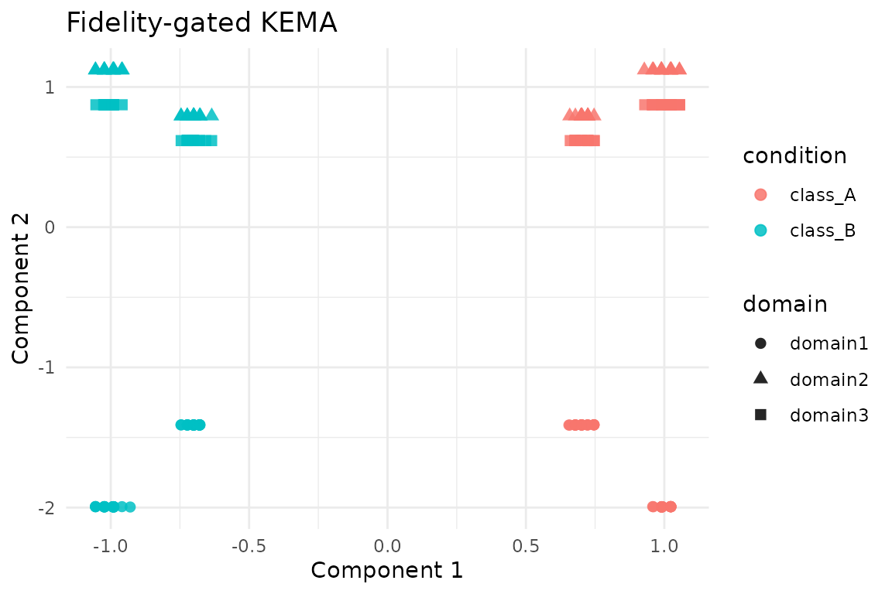
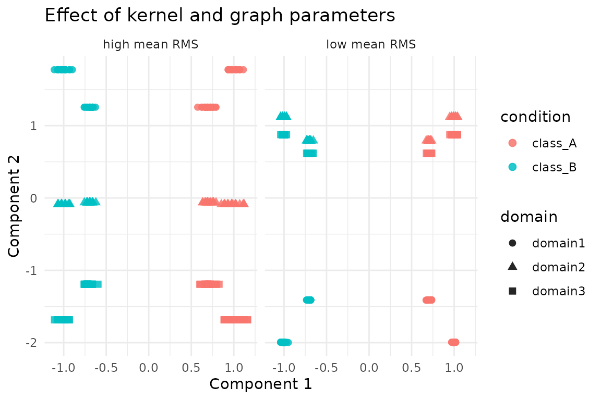

# Kernel Manifold Alignment with kema

## Overview

[`kema()`](https://bbuchsbaum.github.io/manifoldalign/reference/kema.md)
aligns multiple domains by projecting them into a shared latent space
where both manifold geometry and class structure are preserved. The
function supports:

- **Full KEMA** on the complete kernel matrices, with every returned
  component required to pass generalized-eigen residual and
  B-orthogonality checks
- **REKEMA** landmark approximations via `sample_frac`
- A legacy operator backend name that requests eigencore’s certified
  partial quotient solver, with a dense fallback for small uncertified
  problems. The current implementation materializes the reduced quotient
  matrices and is not a linear-memory large-data method

This vignette demonstrates each mode on the shared `alignment_benchmark`
dataset so that comparisons across alignment methods are directly
comparable.

## Setup

``` r

library(manifoldalign)
library(multidesign)
library(multivarious)
library(tibble)
library(dplyr)
library(tidyr)
library(ggplot2)
library(purrr)
```

## Benchmark Hyperdesign

We load `alignment_benchmark`, which provides three domains with two
latent classes and modest domain-specific transformations.

``` r

alignment_benchmark <- manifoldalign::alignment_benchmark
domain_list <- lapply(alignment_benchmark$domains, function(dom) {
  multidesign(dom$x, dom$design)
})
hd <- hyperdesign(domain_list)
labels <- alignment_benchmark$labels
domain_names <- names(domain_list)
domain_sizes <- vapply(domain_list, function(dom) nrow(dom$x), integer(1))
replicated_labels <- rep(labels, length(domain_names))
```

## Full KEMA (Fidelity-Gated Solver)

KEMA solves the original generalized eigenproblem after removing
numerical kernel-null directions and exact graph-component null modes.
Small quotient problems use eigencore’s certified full solver; larger
and operator requests use its constrained generalized LOBPCG solver. A
fit is returned only when its selected positive eigenpairs meet both
eigencore’s certificate and KEMA’s independent residual and
B-orthogonality gates. Because the domains have different feature
dimensions we use
[`multivarious::pass()`](https://bbuchsbaum.github.io/multivarious/reference/pass.html)
(no preprocessing) to avoid broadcasting a shared preprocessor across
incompatible shapes.

``` r

exact_fit <- kema(
  hd,
  y = condition,
  ncomp = 2,
  knn = 3,
  sigma = 0.8,
  solver = "exact",
  preproc = multivarious::pass()
)

exact_fit$fidelity[c("passed", "max_rel_residual", "max_b_orth_offdiag")]
#> $passed
#> [1] TRUE
#> 
#> $max_rel_residual
#> [1] 1.399623e-14
#> 
#> $max_b_orth_offdiag
#> [1] 3.608842e-16
```

``` r

rms_alignment(as.matrix(exact_fit$s), domain_sizes, domain_names)
#> # A tibble: 3 × 3
#>   domain_i domain_j     rms
#>   <chr>    <chr>      <dbl>
#> 1 domain1  domain2  0.0130 
#> 2 domain1  domain3  0.0120 
#> 3 domain2  domain3  0.00105
```

We plot z-scored aligned scores (each component standardized across all
domains); this keeps the visual scale comparable while preserving class
separation.

``` r

score_tbl <- as_tibble(zscore_columns(as.matrix(exact_fit$s)), .name_repair = "minimal")
colnames(score_tbl) <- paste0("comp", seq_len(ncol(score_tbl)))

exact_scores <- score_tbl %>%
  mutate(
    domain = rep(domain_names, times = domain_sizes),
    condition = replicated_labels
  )

ggplot(exact_scores, aes(x = comp1, y = comp2, colour = condition, shape = domain)) +
  geom_point(size = 2.2, alpha = 0.85) +
  labs(title = "Fidelity-gated KEMA", x = "Component 1", y = "Component 2") +
  theme_minimal()
```



The helper below compares score subspaces without assuming component
signs or bases are identifiable.

``` r

subspace_similarity <- function(A, B) {
  A <- as.matrix(A)
  B <- as.matrix(B)
  Qa <- qr.Q(qr(A))
  Qb <- qr.Q(qr(B))
  svd(t(Qa) %*% Qb, nu = 0, nv = 0)$d
}
```

## REKEMA (Landmark Approximation)

Sampling landmarks via `sample_frac` reduces the kernel size. Here we
keep 50% of the samples per domain and run the exact solver on the
reduced system.

``` r

set.seed(2024)
rekema_fit <- kema(
  hd,
  y = condition,
  ncomp = 2,
  knn = 3,
  sigma = 0.8,
  solver = "exact",
  sample_frac = 0.5,
  preproc = multivarious::pass()
)

rekema_fit$eigenvalues$solver
#> [1] "exact"
```

``` r

rms_alignment(as.matrix(rekema_fit$s), domain_sizes, domain_names)
#> # A tibble: 3 × 3
#>   domain_i domain_j     rms
#>   <chr>    <chr>      <dbl>
#> 1 domain1  domain2  0.0111 
#> 2 domain1  domain3  0.00582
#> 3 domain2  domain3  0.00903
```

Even with landmarks the subspace remains close to the full exact
solution.

``` r

subspace_similarity(exact_fit$s[, 1:2], rekema_fit$s[, 1:2])
#> [1] 0.9053154 0.5115096
```

## Operator Backend

`backend = "operator_exact"` is retained for compatibility and requests
the constrained partial eigencore path. Small quotient problems fall
back to the certified dense solver if the partial result is not
certified. With `sample_frac < 1`, it operates on landmark coefficients.
The current implementation materializes the nullspace-reduced quotient
matrices as well as the graph and kernel blocks, so it is not a claim of
end-to-end linear scaling.

``` r

set.seed(2024)
operator_fit <- kema(
  hd,
  y = condition,
  ncomp = 2,
  knn = 3,
  sigma = 0.8,
  solver = "exact",
  sample_frac = 0.5,
  backend = "operator_exact",
  preproc = multivarious::pass()
)

operator_fit$fidelity[c("passed", "eigensolver", "max_rel_residual")]
#> $passed
#> [1] TRUE
#> 
#> $eigensolver
#> [1] "eigencore_lobpcg_deflated"
#> 
#> $max_rel_residual
#> [1] 3.56976e-10
```

``` r

rms_alignment(as.matrix(operator_fit$s), domain_sizes, domain_names)
#> # A tibble: 3 × 3
#>   domain_i domain_j     rms
#>   <chr>    <chr>      <dbl>
#> 1 domain1  domain2  0.0111 
#> 2 domain1  domain3  0.00582
#> 3 domain2  domain3  0.00903
```

Because the same landmark seed is used, the matrix and operator reduced
backends should recover the same score subspace up to numerical
indeterminacy.

``` r

subspace_similarity(rekema_fit$s[, 1:2], operator_fit$s[, 1:2])
#> [1] 1 1
```

## Tuning Key Parameters

The graph neighbourhood size `knn`, the Gaussian kernel width `sigma`,
and the trade-off `u` are the most immediate levers in practice. Smaller
`sigma` emphasises local structure, while larger `u` leans on label
agreement. The grid below reports the mean RMS alignment (smaller is
better) for a few representative settings.

``` r

parameter_grid <- tidyr::expand_grid(
  sigma = c(0.5, 0.8, 1.1),
  knn = c(3, 6),
  u = c(0.35, 0.5, 0.7)
)

grid_summary <- parameter_grid %>%
  mutate(
    mean_rms = purrr::pmap_dbl(
      list(sigma, knn, u),
      function(sigma, knn, u) {
        fit <- kema(
          hd,
          y = condition,
          ncomp = 2,
          knn = knn,
          sigma = sigma,
          u = u,
          solver = "exact",
          preproc = multivarious::pass()
        )

        mean(rms_alignment(as.matrix(fit$s), domain_sizes, domain_names)$rms)
      }
    )
  ) %>%
  arrange(mean_rms)

grid_summary
#> # A tibble: 18 × 4
#>    sigma   knn     u mean_rms
#>    <dbl> <dbl> <dbl>    <dbl>
#>  1   0.8     3  0.7   0.00866
#>  2   0.8     3  0.5   0.00866
#>  3   0.8     6  0.7   0.00866
#>  4   0.8     6  0.5   0.00867
#>  5   0.8     3  0.35  0.00867
#>  6   0.8     6  0.35  0.00868
#>  7   0.5     3  0.7   0.00937
#>  8   0.5     3  0.5   0.00945
#>  9   0.5     3  0.35  0.00950
#> 10   0.5     6  0.7   0.00952
#> 11   0.5     6  0.5   0.00954
#> 12   0.5     6  0.35  0.00955
#> 13   1.1     3  0.7   0.00961
#> 14   1.1     6  0.7   0.00961
#> 15   1.1     3  0.5   0.00961
#> 16   1.1     6  0.5   0.00962
#> 17   1.1     3  0.35  0.00962
#> 18   1.1     6  0.35  0.00962
```

The embedding geometry shifts noticeably between configurations with the
lowest and highest mean RMS:

``` r

best_cfg <- grid_summary %>% slice_min(mean_rms, n = 1, with_ties = FALSE)
worst_cfg <- grid_summary %>% slice_max(mean_rms, n = 1, with_ties = FALSE)

collect_scores <- function(cfg, tag) {
  fit <- kema(
    hd,
    y = condition,
    ncomp = 2,
    knn = cfg$knn[[1]],
    sigma = cfg$sigma[[1]],
    u = cfg$u[[1]],
    solver = "exact",
    preproc = multivarious::pass()
  )

  tbl <- as_tibble(zscore_columns(as.matrix(fit$s)), .name_repair = "minimal")
  colnames(tbl) <- paste0("comp", seq_len(ncol(tbl)))

  tbl %>%
    mutate(
      domain = rep(domain_names, times = domain_sizes),
      condition = replicated_labels,
      config = tag
    )
}

comparison_scores <- dplyr::bind_rows(
  collect_scores(best_cfg, "low mean RMS"),
  collect_scores(worst_cfg, "high mean RMS")
)

 ggplot(comparison_scores, aes(x = comp1, y = comp2, colour = condition, shape = domain)) +
  geom_point(alpha = 0.85, size = 2.1) +
  facet_wrap(~ config) +
  labs(
    title = "Effect of kernel and graph parameters",
    x = "Component 1",
    y = "Component 2"
  ) +
  theme_minimal()
```



In general, tighter kernels (`sigma = 0.5`) with modest neighbourhoods
(`knn = 3`) and balanced supervision (`u = 0.5`) yield the most
consistent alignment on this benchmark, while overly wide kernels and
heavy supervision degrade overlap. Use these diagnostics as a template
when tuning on larger data.

## Summary

- Treat KEMA as a fidelity-gated reference method: a returned fit has
  passed the configured generalized-eigen checks, while a numerically
  unresolved fit raises an error.
- **REKEMA** (`sample_frac < 1`) reduces the computational burden when
  full kernels are too large.
- Use `backend = "operator_exact"` to avoid explicit generalized A/B
  matrices; it does not eliminate graph and kernel storage.
- The RMS alignment tables highlight how closely each backend agrees
  across domains; lower values correspond to tighter alignment.

These examples are deliberately small for clarity—swap in your own
domains and adjust `sigma`, `knn`, or control options to match real
data.
